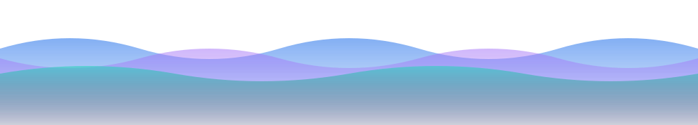

Full-stack engineer shipping **fintech & POS systems** — the kind where real money moves and nothing gets to break. After hours it's **smart contracts**, **particle simulations**, and **machines that draw**.

> Everything moving on this page is hand-built animated SVG, living in this repo. No templates, no widgets. **View source — that's the point.**

| PID | PROCESS | STATUS | NOTES |
|:---|:---|:---|:---|
| `0x01` | [`auction-house`](https://github.com/HamzaMasood7/Auction_Backend_Nestjs) | 🟢 `shipped` | full bidding platform — NestJS API + [React front-end](https://github.com/HamzaMasood7/Auction_Frontend_React) |
| `0x02` | [`erc20-token`](https://github.com/HamzaMasood7/ERC20-Token) | ⛓️ `on-chain` | an ERC-20 written by hand, to understand every line of it |
| `0x03` | [`space-chronicles`](https://github.com/HamzaMasood7/Space-Chronicles) | 🛰️ `orbiting` | mesmerizing imagery straight from NASA's API, in TypeScript |
| `0x04` | [`untended`](https://github.com/HamzaMasood7/untended) | 🧬 `evolving` | glowing particle species left alone to invent their own order |
| `0x05` | [`birth-lottery`](https://github.com/HamzaMasood7/birth-lottery) | 🎲 `live` | be born as a random human, at the world's real odds |
| `0x06` | [`stm32-plotter`](https://github.com/HamzaMasood7/2D-Art-Carafting-Using-STM32-LINEAR-LINES-ONLY) | ⚙️ `hardware` | an art machine on a black pill board — linear lines only |
| `0x07` | [`guess.asm`](https://github.com/HamzaMasood7/Guessing-Game-Assembly-Language) | 👾 `retro` | x86 Assembly guessing game, RNG included, because why not |

&nbsp;

  

<em>"Keep moving forward."</em> — Meet the Robinsons

